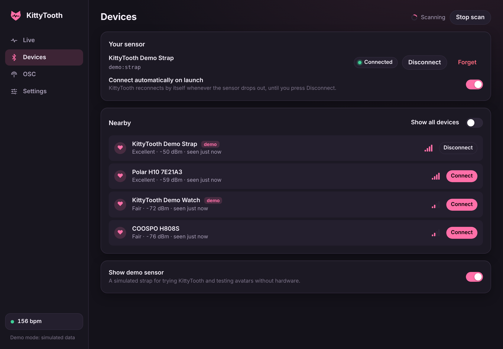
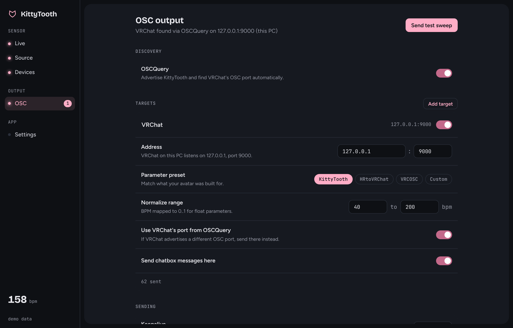
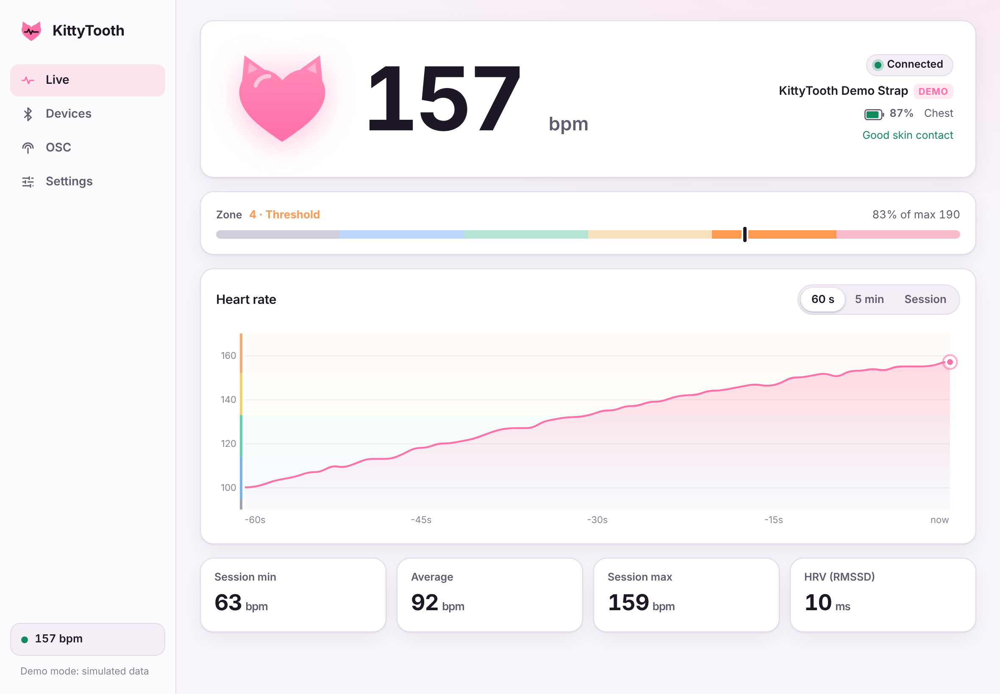

<p align="center"></p>

<h1 align="center">KittyTooth</h1>

<p align="center">Your Bluetooth heart rate, live on your VRChat avatar.</p>

KittyTooth is a small Windows desktop app that reads heart rate from any standard Bluetooth LE
sensor (chest straps, armbands, watches in broadcast mode) and sends it over **OSC** to VRChat
and other OSC apps. It works with avatars built for **HRtoVRChat** and **VRCOSC** out of the box,
has its own richer parameter set, a VRChat chatbox mode, a beat-synced heart, and an OBS overlay.


<table>
<tr>
<td></td>
<td></td>
</tr>
<tr>
<td></td>
<td></td>
</tr>
</table>

<sub>Screenshots are generated automatically by Playwright against the built-in demo sensor
(`npm run screenshots`), so the values shown are simulated.</sub>

## Features

* **Any standard BLE heart rate sensor** (Heart Rate Service 0x180D): Polar, Garmin, Coospo,
  Wahoo, Amazfit/Xiaomi and Galaxy Watch broadcast modes. Battery and body location when
  available. See [docs/DEVICES.md](docs/DEVICES.md).
* **Set and forget**: remembers your sensor, connects on launch, reconnects forever with
  back-off (1, 2, 4, 8, 10 s...) until you press Disconnect, detects stale data.
* **Clean data**: rejects impossible values and one-off spikes, optional smoothing, session
  min/avg/max, HRV (RMSSD, 30 s), heart rate zones.
* **Real heartbeats**: beat events follow the sensor's RR intervals (or BPM if it has none).
* **OSC presets**: KittyTooth, HRtoVRChat compatible, VRCOSC compatible, or fully custom.
  Multiple targets, OSCQuery discovery of VRChat, keepalive, strict 20 msg/s cap per target.
* **VRChat chatbox** with a template (`{hr} bpm {heart}`), 2 s minimum interval, silent mode.
* **Streaming**: always-on-top mini window and a transparent OBS browser source.
* **Tray app**: the tray icon shows your live BPM; KittyTooth keeps sending while minimized.
* Dark/light theme, accent color, keyboard accessible, respects reduced motion.

## Install

Download from the [latest release](../../releases/latest):

| File | What it is |
|---|---|
| `KittyTooth_<version>_x64-setup.exe` | Installer (per-user, no admin needed). Recommended. |
| `KittyTooth_<version>_x64_portable.exe` | Portable app: run it from anywhere. Needs the WebView2 runtime, which Windows 11 already has. |
| `KittyTooth_<version>_amd64.AppImage` | Linux build (bonus). |
| `SHA256SUMS.txt` | Checksums for all files. |

Requirements: Windows 10/11 with Bluetooth 4.0+ (built-in or a USB dongle).

## Quick start

1. **Put on your sensor.** Wet the strap's electrodes, or turn on *heart rate broadcast* on your watch.
2. **Open KittyTooth → Devices** and click **Connect** next to your sensor. It's remembered from now on.
3. **In VRChat, enable OSC**: Action Menu → Options → OSC → *Enabled*.
4. **Pick the preset your avatar uses** under **OSC** (KittyTooth, HRtoVRChat or VRCOSC) and press
   **Send test sweep** to watch your avatar react, even without wearing the strap.

No sensor yet? Click **Try the demo strap** on the Live screen.

## Avatar setup

Full address/type/range tables are in [docs/PARAMETERS.md](docs/PARAMETERS.md).

### KittyTooth preset (new avatars)

Add these to your avatar's *Expression Parameters* (only the ones you use; mark them *not
synced* if only you need them, *synced* if others should see them):

| Parameter | Type | Use it for |
|---|---|---|
| `KittyTooth/HR` | Int | Number displays (or use `Ones`/`Tens`/`Hundreds` Ints for digit textures) |
| `KittyTooth/Normalized` | Float | Blend trees, gauges, color ramps (0 at 40 bpm, 1 at 200 bpm by default) |
| `KittyTooth/BeatPulse` | Bool | Trigger a "thump" animation on each beat |
| `KittyTooth/Beat` | Bool | Toggles every beat; cheaper to sync than `BeatPulse` |
| `KittyTooth/Connected` | Bool | Hide the display when no sensor is connected |
| `KittyTooth/Zone` | Int | Change colors by training zone (0-5) |
| `KittyTooth/HRV`, `Percent`, `Battery` | Float | Extras |

Tip: VRChat syncs at roughly 5-10 updates/s, so for remote players prefer the `Beat` toggle
and drive the animation locally rather than relying on the 100 ms `BeatPulse`.

### HRtoVRChat preset (existing HRtoVRChat avatars / prefab)

Select **HRtoVRChat compatible**. KittyTooth sends `HR`, `onesHR`, `tensHR`, `hundredsHR`,
`isHRConnected`, `isHRActive`, `isHRBeat`, `HeartBeatToggle`, `HRPercent`, `FullHRPercent`
exactly like HRtoVRChat_OSC, including its 0-255 percent range. No avatar changes needed.

### VRCOSC preset (existing VRCOSC Heartrate avatars)

Select **VRCOSC Heartrate compatible**. KittyTooth sends `VRCOSC/Heartrate/Enabled`, `Connected`,
`Value`, `Normalised`, `Average`, `Units`, `Tens`, `Hundreds` and `Beat`, with the same types
as VRCOSC (the digit parameters are floats, digit ÷ 10). Don't run VRCOSC's Heartrate module
at the same time.

### Custom

Choose **Custom** and map any value (BPM, digits, zone, HRV, beat, ...) to any address and
type. Bare names get the `/avatar/parameters/` prefix.

### OBS overlay

Settings → OBS overlay shows a URL like `http://127.0.0.1:9123/overlay`. Add it in OBS as a
*Browser source* (transparent background). Options: `?size=120`, `?color=ff6fa8`, `?text=ffffff`,
`?hide=1` (hide when disconnected), `?unit=0`.

## FAQ

**KittyTooth says "Bluetooth is turned off" / "No Bluetooth adapter".**
Turn Bluetooth on in *Settings → Bluetooth & devices*. If the toggle is missing, your PC has no
working Bluetooth: check Device Manager (update or reinstall the Bluetooth driver) or plug in a
Bluetooth 4.0+ USB dongle. KittyTooth notices when the adapter comes back and reconnects.

**My strap doesn't show up in the list.**
* Chest straps only advertise while worn: wet the electrodes and put it on.
* It may be connected to something else (phone app, Zwift, bike computer, watch). Disconnect it there.
* Watches must be in *broadcast heart rate* mode.
* Toggle *Show all devices*: some sensors don't advertise the heart rate service until connected.

**It connects, then says "Sensor not responding" or "Sensor is busy".**
Another app or device is holding the connection. If you paired the strap in Windows for another
app, remove it in *Bluetooth & devices* and connect from KittyTooth instead. A dongle on a USB 3
port right next to the PC can suffer interference: try a USB 2 port or an extension cable.

**VRChat doesn't receive anything.**
* OSC must be enabled in VRChat (Action Menu → Options → OSC). After changing avatars, use
  *OSC → Reset Config* in VRChat if parameters were added to an avatar later.
* Check the **OSC** screen: the live log shows every message sent and the target address.
* The avatar must have parameters with exactly the names of the preset you picked.
* If you changed VRChat's OSC port (`--osc=` launch option), either keep *Use VRChat's port from
  OSCQuery* on or enter the port manually.
* Running another heart rate app at the same time can overwrite the same parameters.

**Windows Firewall / antivirus.**
KittyTooth only sends UDP to `127.0.0.1:9000` by default and its OSCQuery and overlay servers
listen on loopback only, so Windows Firewall shouldn't prompt. If you send to another PC (e.g.
a Quest on Wi-Fi or a second PC), allow KittyTooth through *Windows Defender Firewall → Allow an
app* for private networks, and make sure both devices are on the same network.

**Does it work with Quest standalone?**
Yes, if the Quest runs VRChat with OSC enabled: add a target with the Quest's IP address and
port 9000.

**Where are my settings and logs?**
`%APPDATA%\app.kittytooth.desktop\config.json` and `%LOCALAPPDATA%\app.kittytooth.desktop\logs\`.
*Settings → Copy diagnostics* copies everything useful for a bug report.

## Development

```bash
npm ci
npm run tauri dev          # app with hot reload
npm run dev                # UI only, in the browser with the simulated sensor
cargo test --workspace     # Rust unit + integration tests (mock sensor → UDP listener)
npm run check && npm run lint && npm test && npm run e2e
npm run screenshots        # regenerate README screenshots
```

Linux needs `libwebkit2gtk-4.1-dev libdbus-1-dev libayatana-appindicator3-dev librsvg2-dev`.
Architecture and milestones: [PLAN.md](PLAN.md). Design decisions: [DECISIONS.md](DECISIONS.md).
Requirement coverage: [CHECKLIST.md](CHECKLIST.md).

## License

[MIT](LICENSE)
