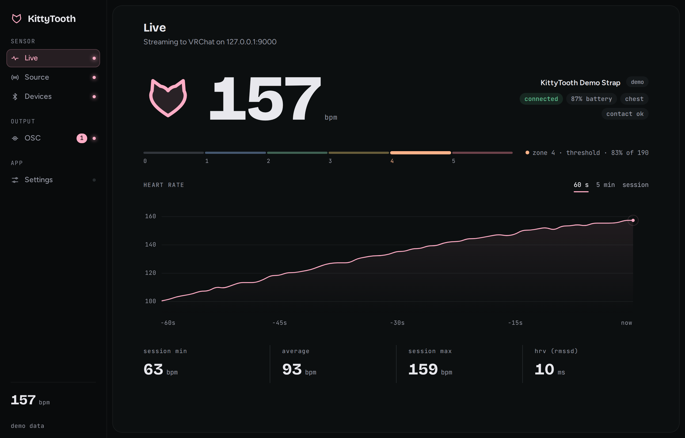
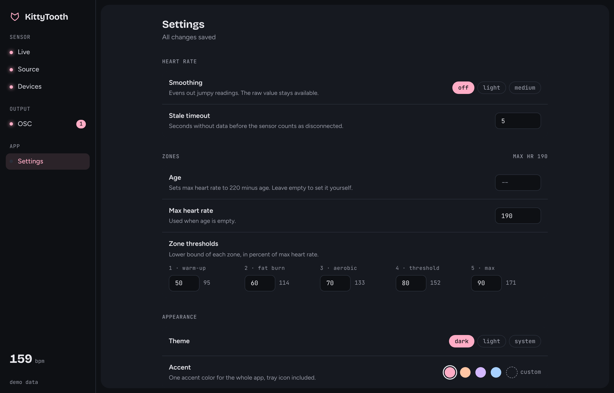
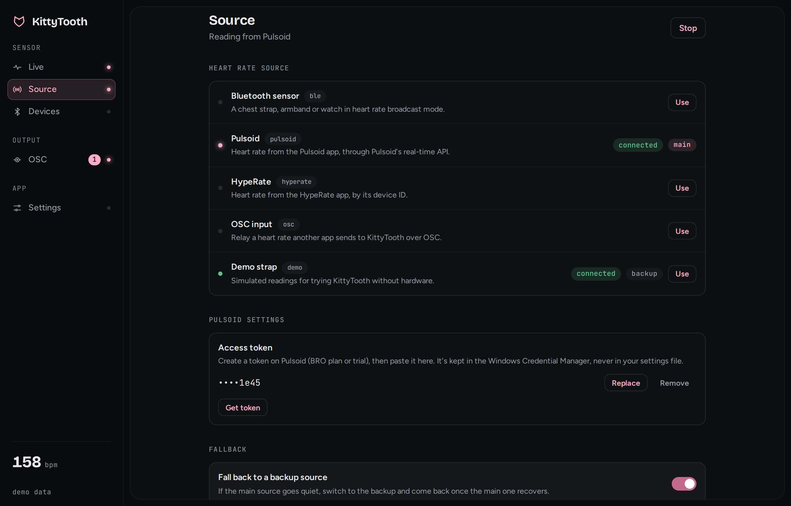
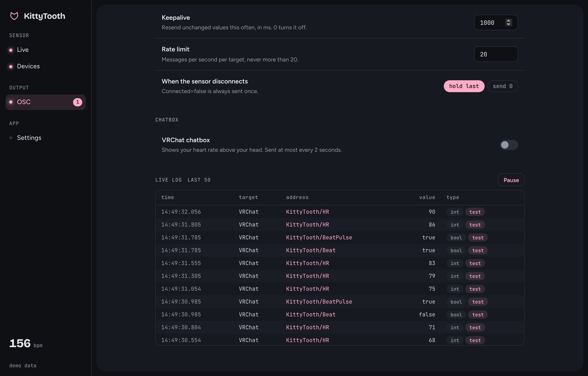

<p align="center"></p>

<h1 align="center">KittyTooth</h1>

<p align="center">Your Bluetooth heart rate, live on your VRChat avatar.</p>

KittyTooth is a small Windows desktop app that reads heart rate from any standard Bluetooth LE
sensor (chest straps, armbands, watches in broadcast mode) and sends it over **OSC** to VRChat
and other OSC apps. It works with avatars built for **HRtoVRChat** and **VRCOSC** out of the box,
has its own richer parameter set, a VRChat chatbox mode, a beat-synced heart, and an OBS overlay.



<table>
<tr>
<td></td>
<td></td>
</tr>
<tr>
<td></td>
<td></td>
</tr>
<tr>
<td></td>
<td></td>
</tr>
</table>

<sub>Screenshots are generated automatically by Playwright against the built-in demo sensor
(`npm run screenshots`), so the values shown are simulated.</sub>

## Features

* **Any standard BLE heart rate sensor** (Heart Rate Service 0x180D): Polar, Garmin, Coospo,
  Wahoo, Amazfit/Xiaomi and Galaxy Watch broadcast modes. Battery and body location when
  available. See [docs/DEVICES.md](docs/DEVICES.md).
* **Six heart rate sources**: Bluetooth LE (default), **ANT+** (USB stick), **Pulsoid**,
  **HypeRate**, **OSC input** (relay from another app) and a demo strap. One is active at a time; switching is instant.
  Optional **fallback**: if the main source goes quiet, a backup takes over and hands back
  when the main one recovers.
* **Set and forget**: remembers your sensor, connects on launch, reconnects forever with
  back-off (1, 2, 4, 8, 10 s...) until you press Disconnect, detects stale data.
* **Clean data**: rejects impossible values and one-off spikes, optional smoothing, session
  min/avg/max, HRV (RMSSD, 30 s), heart rate zones.
* **Real heartbeats**: beat events follow the sensor's RR intervals (or BPM if it has none).
* **OSC presets**: KittyTooth, HRtoVRChat compatible, VRCOSC compatible, or fully custom.
  Multiple targets, OSCQuery discovery of VRChat, keepalive, strict 20 msg/s cap per target.
* **VRChat chatbox** with a template (`{hr} bpm {heart}`), 2 s minimum interval, silent mode.
* **Heart rate alerts** (Settings → Alerts): high and low limits, a wait so one spike doesn't set
  them off, and reminders while it lasts. Shows a desktop notification, a chime (rising = high,
  falling = low), a banner and a glowing mini window, and can post the warning to your VRChat
  chatbox so friends nearby see it. A *Test alert* button tries it out. Not a medical device.
* **SteamVR overlay** (optional, Settings → SteamVR): your BPM on your wrist or in view inside a
  PC VR headset, red for a high alert and amber for a low one, plus a heartbeat-like controller
  buzz when an alert fires. Off by default; does nothing if SteamVR isn't installed.
* **Streaming**: always-on-top mini window and a transparent OBS browser source.
* **Tray app**: the tray icon shows your live BPM; KittyTooth keeps sending while minimized.
* Dark/light theme, accent color, springy animations (Settings → Appearance → Motion: on, reduced
  or follow Windows), keyboard accessible.

## Install

Download from the [latest release](../../releases/latest):

| File | What it is |
|---|---|
| `KittyTooth_<version>_x64-setup.exe` | Installer (per-user, no admin needed). Recommended. |
| `KittyTooth_<version>_x64_portable.exe` | Portable app: run it from anywhere. Needs the WebView2 runtime, which Windows 11 already has. |
| `KittyTooth_<version>_amd64.AppImage` | Linux build (bonus). |
| `SHA256SUMS.txt` | Checksums for all files. |

Requirements: Windows 10/11 with Bluetooth 4.0+ (built-in or a USB dongle).

## Resource usage

KittyTooth is two parts, and you can see both in Task Manager:

| Process | What it does | RAM | CPU |
|---|---|---|---|
| **KittyTooth** | Bluetooth, heart rate processing, OSC, OBS overlay server | ~9 MB | ~0% |
| **WebView2: KittyTooth** (under *WebView2 Manager*) | The window you see | ~95 MB | ~1% |
| **WebView2 Manager** (whole group, including the line above) | Microsoft's shared browser engine that draws the window | ~175 MB | ~1-8% while the window is open |

Measured on Windows 11 with v1.1.0, window open on the Live screen with a heart rate coming in.
CPU in the WebView2 group depends on what's on screen: the live graph and animations cost a few
percent while visible.

* **The part that matters for VRChat is tiny.** Everything time-critical (sensor → OSC) runs in
  the ~9 MB KittyTooth process, independent of the window.
* **Close the window to the tray** (the default when you press X) and the page stops drawing, so
  its CPU drops to near zero. WebView2 keeps its memory so the window reopens instantly.
* **Want lower CPU with the window open?** *Settings → Appearance → Motion → reduced* turns the
  animations off. The ~170 MB of WebView2 is the cost of having a window at all; it is freed only
  when you quit from the tray (which also stops sending to VRChat).

## Quick start

1. **Put on your sensor.** Wet the strap's electrodes, or turn on *heart rate broadcast* on your watch.
2. **Open KittyTooth → Devices** and click **Connect** next to your sensor. It's remembered from now on.
3. **In VRChat, enable OSC**: Action Menu → Options → OSC → *Enabled*.
4. **Pick the preset your avatar uses** under **OSC** (KittyTooth, HRtoVRChat or VRCOSC) and press
   **Send test sweep** to watch your avatar react, even without wearing the strap.

No sensor yet? Click **Try the demo strap** on the Live screen.

## Heart rate sources

Pick one on the **Source** page. The Live screen shows which one is feeding readings
(`ble`, `ant`, `pulsoid`, `hyperate`, `osc`, `demo`), and readings a source can't provide (HRV,
battery, skin contact) show as *not available from this source* rather than 0.

| Source | What you need | Provides |
|---|---|---|
| Bluetooth | A strap or watch in broadcast mode, picked on **Devices** | HR, RR/HRV, battery, contact |
| ANT+ | A USB ANT+ stick (Garmin USB2 / USB-m or a clone) and a strap or watch broadcasting ANT+ HR. On Windows the stick needs the WinUSB driver (see below) | HR, RR/HRV, battery (most straps) |
| Pulsoid | A Pulsoid access token: press **Get token** (opens pulsoid.net/ui/keys, BRO plan or trial), paste it | HR, monitor battery |
| HypeRate | Your HypeRate device ID (shown in the HypeRate app) | HR |
| OSC input | Another app sending an int or float to KittyTooth's port (default `9010`, address `/avatar/parameters/HR`) | HR |
| Demo | Nothing | Everything (simulated) |

Tokens and keys are stored in the **Windows Credential Manager** (service `KittyTooth`), never
in `config.json`. They are masked in the UI, never logged, and left out of *Copy diagnostics*.
Network sources reconnect with the same back-off as Bluetooth; a rejected token, key or device
ID stops retrying (with a plain-language message) until you change it.

**ANT+**: KittyTooth pairs with the first ANT+ heart rate monitor it hears. ANT+ sends the time
of every beat, so KittyTooth works out RR intervals and HRV even for Garmin watches (e.g. Fenix,
Forerunner with *Broadcast Heart Rate*), which send no RR over Bluetooth. Only one program can use
the stick at a time: close Garmin Express, Zwift and similar apps first. On Windows the stick must
use the **WinUSB** driver: run [Zadig](https://zadig.akeo.ie), choose *Options → List All Devices*,
pick the ANT USB stick, select *WinUSB* and press *Replace Driver*. See
[docs/DEVICES.md](docs/DEVICES.md#ant).

**Fallback**: turn on *Fall back to a backup source*, pick the backup and how many seconds the
main source may be quiet. The backup stays connected so it can take over instantly; KittyTooth
switches back once the main source has delivered steadily for 3 seconds.

## Avatar setup

Full address/type/range tables are in [docs/PARAMETERS.md](docs/PARAMETERS.md).

### KittyTooth preset (new avatars)

Add these to your avatar's *Expression Parameters* (only the ones you use; mark them *not
synced* if only you need them, *synced* if others should see them):

| Parameter | Type | Use it for |
|---|---|---|
| `KittyTooth/HR` | Int | Number displays (or use `Ones`/`Tens`/`Hundreds` Ints for digit textures) |
| `KittyTooth/Normalized` | Float | Blend trees, gauges, color ramps (0 at 40 bpm, 1 at 200 bpm by default) |
| `KittyTooth/BeatPulse` | Bool | Trigger a "thump" animation on each beat |
| `KittyTooth/Beat` | Bool | Toggles every beat; cheaper to sync than `BeatPulse` |
| `KittyTooth/Connected` | Bool | Hide the display when no sensor is connected |
| `KittyTooth/Zone` | Int | Change colors by training zone (0-5) |
| `KittyTooth/HRV`, `Percent`, `Battery` | Float | Extras |

Tip: VRChat syncs at roughly 5-10 updates/s, so for remote players prefer the `Beat` toggle
and drive the animation locally rather than relying on the 100 ms `BeatPulse`.

### HRtoVRChat preset (existing HRtoVRChat avatars / prefab)

Select **HRtoVRChat compatible**. KittyTooth sends `HR`, `onesHR`, `tensHR`, `hundredsHR`,
`isHRConnected`, `isHRActive`, `isHRBeat`, `HeartBeatToggle`, `HRPercent`, `FullHRPercent`
exactly like HRtoVRChat_OSC, including its 0-255 percent range. No avatar changes needed.

### VRCOSC preset (existing VRCOSC Heartrate avatars)

Select **VRCOSC Heartrate compatible**. KittyTooth sends `VRCOSC/Heartrate/Enabled`, `Connected`,
`Value`, `Normalised`, `Average`, `Units`, `Tens`, `Hundreds` and `Beat`, with the same types
as VRCOSC (the digit parameters are floats, digit ÷ 10). Don't run VRCOSC's Heartrate module
at the same time.

### Custom

Choose **Custom** and map any value (BPM, digits, zone, HRV, beat, ...) to any address and
type. Bare names get the `/avatar/parameters/` prefix.

### OBS overlay

Settings → OBS overlay shows a URL like `http://127.0.0.1:9123/overlay`. Add it in OBS as a
*Browser source* (transparent background). Options: `?size=120`, `?color=ff6fa8`, `?text=ffffff`,
`?hide=1` (hide when disconnected), `?unit=0`.

## SteamVR overlay and controller buzz

Desktop notifications don't reach you inside a headset, so KittyTooth can show your heart rate in
SteamVR itself. Turn it on in **Settings → SteamVR**:

* **Show overlay**: a small card with the cat-head logo and your BPM, in the app's colours. Put it
  on your **left wrist** or **right wrist** (it sits on top of the controller, like a watch: look
  down at your hand) or **in view** (always visible, a little below eye level). Choose the size
  and opacity. During a heart rate alert it turns **red** (high) or **amber** (low) and says
  *HIGH* or *LOW*.
* **Fade when not looking** (on by default, wrist only): like a watch, the wrist overlay fades in
  when you look at it and out when you look away. *Look angle* sets how close to the middle of
  your view it has to be (narrow, normal, wide). Alerts always show, wherever you look.
* **Buzz on alerts**: a short double pulse, like a heartbeat, on the left, right or both
  controllers when an alert fires and on each reminder. It follows your *Alerts* settings, so turn
  alerts on first. *Test alert* tries both the red overlay and the buzz.

KittyTooth never starts SteamVR. While SteamVR isn't running it says *SteamVR not running* and
connects by itself within a few seconds of SteamVR starting; when you quit SteamVR it lets go
cleanly. It talks to SteamVR on its own thread, so OSC to VRChat is never held up. Works with any
SteamVR headset (Index, Vive, Quest via Link or Virtual Desktop, Pico, ...) on Windows or Linux.

## FAQ

**KittyTooth says "Bluetooth is turned off" / "No Bluetooth adapter".**
Turn Bluetooth on in *Settings → Bluetooth & devices*. If the toggle is missing, your PC has no
working Bluetooth: check Device Manager (update or reinstall the Bluetooth driver) or plug in a
Bluetooth 4.0+ USB dongle. KittyTooth notices when the adapter comes back and reconnects.

**My strap doesn't show up in the list.**
* Chest straps only advertise while worn: wet the electrodes and put it on.
* It may be connected to something else (phone app, Zwift, bike computer, watch). Disconnect it there.
* Watches must be in *broadcast heart rate* mode.
* Toggle *Show all devices*: some sensors don't advertise the heart rate service until connected.

**It connects, then says "Sensor not responding" or "Sensor is busy".**
Another app or device is holding the connection. If you paired the strap in Windows for another
app, remove it in *Bluetooth & devices* and connect from KittyTooth instead. A dongle on a USB 3
port right next to the PC can suffer interference: try a USB 2 port or an extension cable.

**VRChat doesn't receive anything.**
* OSC must be enabled in VRChat (Action Menu → Options → OSC). After changing avatars, use
  *OSC → Reset Config* in VRChat if parameters were added to an avatar later.
* Check the **OSC** screen: the live log shows every message sent and the target address.
* The avatar must have parameters with exactly the names of the preset you picked.
* If you changed VRChat's OSC port (`--osc=` launch option), either keep *Use VRChat's port from
  OSCQuery* on or enter the port manually.
* Running another heart rate app at the same time can overwrite the same parameters.

**Windows Firewall / antivirus.**
KittyTooth only sends UDP to `127.0.0.1:9000` by default and its OSCQuery and overlay servers
listen on loopback only, so Windows Firewall shouldn't prompt. If you send to another PC (e.g.
a Quest on Wi-Fi or a second PC), allow KittyTooth through *Windows Defender Firewall → Allow an
app* for private networks, and make sure both devices are on the same network.

**Does it work with Quest standalone?**
Yes, if the Quest runs VRChat with OSC enabled: add a target with the Quest's IP address and
port 9000.

**HRV says "this sensor doesn't send beat intervals".**
HRV is worked out from the time between beats (RR intervals). Garmin watches (Fenix, Forerunner,
Venu...) and many optical bands don't send those over Bluetooth, only the BPM. Use the watch's
ANT+ broadcast with a USB ANT+ stick instead (ANT+ includes beat timing), or a chest strap such as
a Polar H10.

**Who sees heart rate alerts?**
Only you, unless you turn on *Show in VRChat chatbox*: then the alert text appears above your
avatar for everyone nearby. Alerts are a reminder, not a medical device. If the desktop
notification doesn't appear with the portable exe, install KittyTooth once with the setup exe
(Windows only shows notifications from apps it knows), or rely on the sound and chatbox.

**How do I see my heart rate or alerts inside my headset?**
Turn on *Settings → SteamVR* (PC VR through SteamVR only). If the status says *SteamVR not found*,
SteamVR isn't installed; *SteamVR not running* means start it and KittyTooth connects by itself.
If the wrist overlay doesn't appear, check that controller is on (it hides while the controller is
off), or switch to *in view*. If you feel no buzz, make sure heart rate alerts are on and try
*Test alert*. On Quest standalone (no PC), there is no SteamVR: use *Show in VRChat chatbox* for
alerts instead.

**Where are my settings and logs?**
`%APPDATA%\app.kittytooth.desktop\config.json` and `%LOCALAPPDATA%\app.kittytooth.desktop\logs\`.
*Settings → Copy diagnostics* copies everything useful for a bug report.

## Development

```bash
npm ci
npm run tauri dev          # app with hot reload
npm run dev                # UI only, in the browser with the simulated sensor
cargo test --workspace     # Rust unit + integration tests (mock sensor → UDP listener)
npm run check && npm run lint && npm test && npm run e2e
npm run screenshots        # regenerate README screenshots
```

Linux needs `libwebkit2gtk-4.1-dev libdbus-1-dev libayatana-appindicator3-dev librsvg2-dev libssl-dev`.

The HypeRate source needs a developer API key. Builds read it at compile time from
`KITTYTOOTH_HYPERATE_KEY` (CI passes the `HYPERATE_API_KEY` repository secret); without it,
users paste their own key on the Source page. Never commit a key.
Architecture and milestones: [PLAN.md](PLAN.md). Design decisions: [DECISIONS.md](DECISIONS.md).
Requirement coverage: [CHECKLIST.md](CHECKLIST.md).

## License

[MIT](LICENSE)
